# Домашнее задание к занятию «Микросервисы: подходы» - Старцев Данила Антонович

Вы работаете в крупной компании, которая строит систему на основе микросервисной архитектуры.
Вам как DevOps-специалисту необходимо выдвинуть предложение по организации инфраструктуры для разработки и эксплуатации.

## Задача 1: Обеспечить разработку

Предложите решение для обеспечения процесса разработки: хранение исходного кода, непрерывная интеграция и непрерывная поставка. 
Решение может состоять из одного или нескольких программных продуктов и должно описывать способы и принципы их взаимодействия.

Решение должно соответствовать следующим требованиям:
- облачная система;
- система контроля версий Git;
- репозиторий на каждый сервис;
- запуск сборки по событию из системы контроля версий;
- запуск сборки по кнопке с указанием параметров;
- возможность привязать настройки к каждой сборке;
- возможность создания шаблонов для различных конфигураций сборок;
- возможность безопасного хранения секретных данных (пароли, ключи доступа);
- несколько конфигураций для сборки из одного репозитория;
- кастомные шаги при сборке;
- собственные докер-образы для сборки проектов;
- возможность развернуть агентов сборки на собственных серверах;
- возможность параллельного запуска нескольких сборок;
- возможность параллельного запуска тестов.

Обоснуйте свой выбор.

Я предлагаю остановиться на GitLab, в облачной версии (GitLab.com) или в self-managed варианте, если компания готова держать его у себя. GitLab закрывает сразу всё: и хранение кода, и CI/CD, и управление секретами, и реестр контейнеров. Не нужно склеивать пять разных инструментов и потом чинить их интеграцию.

Почему именно GitLab, по пунктам из требований.

Облачная система и Git. GitLab это облачный сервис с Git-репозиториями из коробки. Каждый микросервис живёт в своём репозитории, это стандартная практика для микросервисов.

Запуск сборки по событию из VCS. Pipeline запускается на push, на merge request, по тегу или по расписанию. Это базовая функциональность GitLab CI/CD.

Запуск сборки по кнопке с параметрами. В GitLab есть ручной запуск пайплайна через when: manual и механизм variables, через которые можно передать параметры в сборку вручную.

Привязка настроек к каждой сборке и шаблоны. В .gitlab-ci.yml поддерживаются include, extends, !reference и CI/CD-компоненты. Можно один раз описать шаблон сборки, а в каждом репозитории только подставлять переменные. Это удобно, когда сервисов много и они похожи.

Секреты. GitLab умеет хранить protected variables и masked variables. Для более серьёзных сценариев есть интеграция с внешними хранилищами секретов, например с Vault. Секреты не попадают в логи, если включить маскирование.

Несколько конфигураций из одного репозитория. Это делается через rules, only/except и разные job’ы для веток или тегов. Один репозиторий может собирать dev, staging и production конфигурации.

Кастомные шаги и свои Docker-образы. Любой job может использовать image: со своим или публичным образом. Шаги описываются shell-командами или скриптами, так что кастомная логика не ограничена.

Свои агенты сборки. GitLab Runner можно установить на собственных серверах, в Docker или в Kubernetes. Это закрывает требование про агентов на своих мощностях.

Параллельные сборки и тесты. Job’ы в одной стадии выполняются параллельно. Через parallel: и matrix: можно размножить один job на несколько конфигураций, и тесты тоже пойдут параллельно.

В итоге GitLab это не набор разрозненных утилит, а одна платформа с единой моделью прав, единым интерфейсом и предсказуемым поведением. Для DevOps-команды это меньше точек отказа и меньше интеграционной работы.

## Задача 2: Логи

Предложите решение для обеспечения сбора и анализа логов сервисов в микросервисной архитектуре.
Решение может состоять из одного или нескольких программных продуктов и должно описывать способы и принципы их взаимодействия.

Решение должно соответствовать следующим требованиям:
- сбор логов в центральное хранилище со всех хостов, обслуживающих систему;
- минимальные требования к приложениям, сбор логов из stdout;
- гарантированная доставка логов до центрального хранилища;
- обеспечение поиска и фильтрации по записям логов;
- обеспечение пользовательского интерфейса с возможностью предоставления доступа разработчикам для поиска по записям логов;
- возможность дать ссылку на сохранённый поиск по записям логов.

Обоснуйте свой выбор.

Для сбора и анализа логов я предлагаю стек ELK: Elasticsearch, Logstash и Kibana. В связке с доставкой логов через Filebeat или Vector. Если хочется совсем минималистично, можно начать с Elasticsearch плюс Kibana плюс Vector, без Logstash, потому что Vector умеет и собирать, и фильтровать, и отправлять в Elasticsearch.

Как это работает.

Сбор логов в центральное хранилище. На каждом хосте или в каждом контейнере работает агент (Filebeat или Vector), который читает stdout контейнеров и отправляет записи в Elasticsearch. Если нужна буферизация и сложная обработка, между агентом и Elasticsearch ставится Logstash.

Минимальные требования к приложениям. Приложения просто пишут в stdout. Никаких специальных библиотек для отправки логов в сеть не нужно. Агент забирает stdout через Docker API или через файлы в /var/lib/docker/containers.

Гарантированная доставка. Filebeat и Vector хранят состояние прочитанных файлов и умеют повторять отправку при сбоях. Logstash может использовать persistent queues. В связке это даёт доставку «хотя бы один раз» и защиту от потери при кратковременных сбоях Elasticsearch.

Поиск и фильтрация. Elasticsearch индексирует поля, а Kibana даёт интерфейс для поиска по ним. Можно искать по service_name, level, host, message и любым другим полям, которые агент добавил при обработке.

Интерфейс для разработчиков и ссылки на поиск. Kibana поддерживает Spaces и роли, так что разработчикам можно дать доступ только к их индексам или только на чтение. Сохранённый поиск в Kibana имеет свой URL, которым можно поделиться с коллегой или приложить к инциденту.

Почему не Loki? Loki легче и дешевле по ресурсам, но он хуже подходит, если нужен полнотекстовый поиск по большому объёму логов и сложная фильтрация по полям. ELK в этом смысле мощнее и лучше закрывает требование про поиск и фильтрацию. Если объёмы логов небольшие и хочется сэкономить, Loki это разумная альтернатива, но в рамках учебного задания ELK выглядит более полным ответом.

## Задача 3: Мониторинг

Предложите решение для обеспечения сбора и анализа состояния хостов и сервисов в микросервисной архитектуре.
Решение может состоять из одного или нескольких программных продуктов и должно описывать способы и принципы их взаимодействия.

Решение должно соответствовать следующим требованиям:
- сбор метрик со всех хостов, обслуживающих систему;
- сбор метрик состояния ресурсов хостов: CPU, RAM, HDD, Network;
- сбор метрик потребляемых ресурсов для каждого сервиса: CPU, RAM, HDD, Network;
- сбор метрик, специфичных для каждого сервиса;
- пользовательский интерфейс с возможностью делать запросы и агрегировать информацию;
- пользовательский интерфейс с возможностью настраивать различные панели для отслеживания состояния системы.

Обоснуйте свой выбор.

Для мониторинга я предлагаю Prometheus плюс Grafana, плюс Node Exporter для хостов и cAdvisor для контейнеров. Это стандартный и хорошо проверенный стек для микросервисов.

Сбор метрик со всех хостов. Node Exporter на каждом хосте отдаёт метрики CPU, RAM, дисков и сети. Prometheus периодически их забирает.

Метрики ресурсов хостов. Node Exporter закрывает CPU, память, файловые системы, сетевые интерфейсы и ещё кучу системных показателей.

Метрики по каждому сервису. Здесь два уровня. cAdvisor собирает потребление контейнеров (CPU, память, сеть, диск) на уровне Docker. А сами сервисы отдают свои бизнес-метрики через /metrics. У security и uploader уже есть prometheus-flask-exporter, который отдаёт HTTP-метрики. У storage (Silo) есть эндпоинт /minio/v2/metrics/cluster, который тоже можно скрейпить.

Метрики, специфичные для сервиса. Тот же prometheus-flask-exporter позволяет добавлять кастомные счётчики и гистограммы. Например, количество загруженных файлов или время ответа на конкретный эндпоинт. Это уже дело разработчика, но инфраструктура готова.

UI для запросов и агрегации. Prometheus имеет встроенный UI с PromQL, где можно делать запросы и агрегировать данные. Grafana идёт дальше и позволяет строить панели, смешивать разные источники и делать дашборды для разных аудиторий.

Настройка панелей. В Grafana панели собираются из запросов к Prometheus. Можно сделать отдельный дашборд про распределение запросов по сервисам, отдельный про ресурсы хостов, отдельный про ошибки.

Почему Prometheus, а не, скажем, Zabbix или VictoriaMetrics? Prometheus это де-факто стандарт для Kubernetes и контейнерных сред. Он хорошо дружит с микросервисами, у него простой pull-механизм и мощный язык запросов. Grafana даёт визуализацию, которую разработчики и дежурные могут читать без изучения PromQL. Связка получается гибкой и не требует лицензий.

## Задача 4: Логи * (необязательная)

Продолжить работу по задаче API Gateway: сервисы, используемые в задаче, пишут логи в stdout. 

Добавить в систему сервисы для сбора логов Vector + ElasticSearch + Kibana со всех сервисов, обеспечивающих работу API.

### Результат выполнения: 

docker compose файл, запустив который можно перейти по адресу http://localhost:8081, по которому доступна Kibana.
Логин в Kibana должен быть admin, пароль qwerty123456.

В `docker-compose.yaml` добавлены сервисы `elasticsearch`, `kibana` (порт 8081) и `vector`. Vector читает stdout всех контейнеров через Docker socket, обогащает записи именем сервиса и отправляет их в Elasticsearch. Для Kibana создан сервисный токен доступа.

**Ответ:**
1. Создан Data View `docker-logs-*` для чтения индексов.

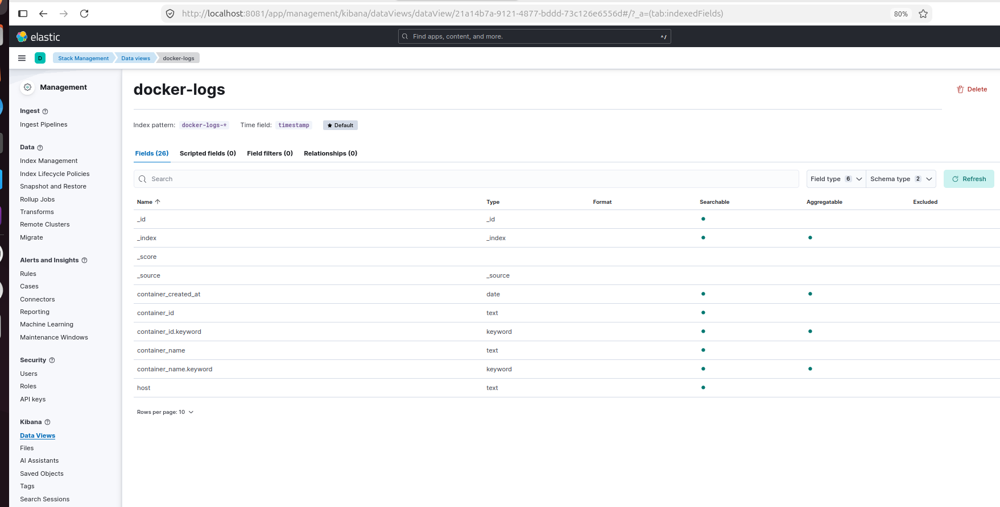

2. В разделе Discover отображаются логи всех сервисов. Настроен и сохранен поиск `nginx-logs` по фильтру `service : "nginx"`.

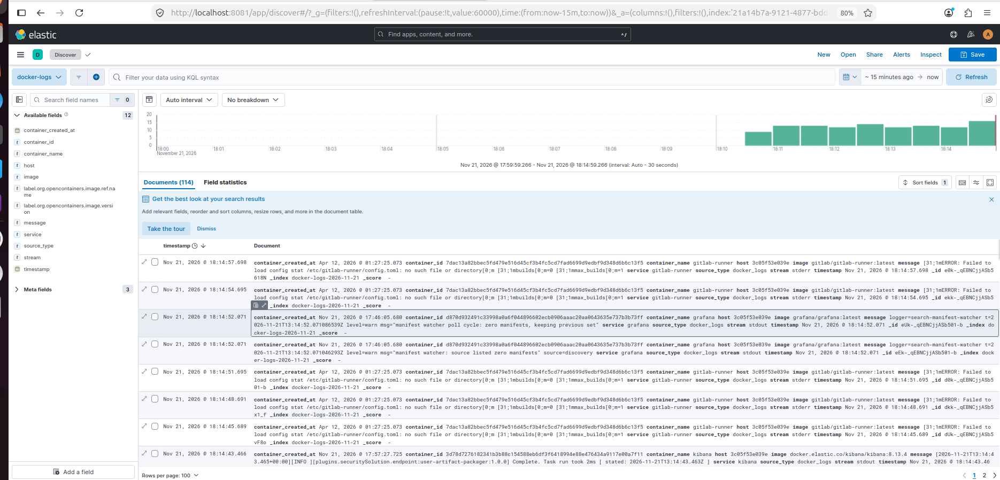

3. Ссылка на сохраненный поиск сформирована.

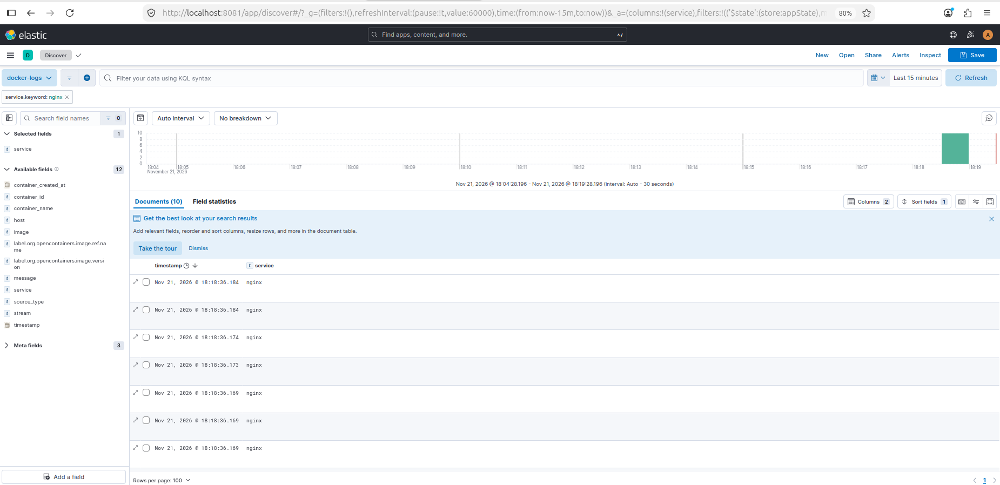

## Задача 5: Мониторинг * (необязательная)

Продолжить работу по задаче API Gateway: сервисы, используемые в задаче, предоставляют набор метрик в формате prometheus:

- сервис security по адресу /metrics,
- сервис uploader по адресу /metrics,
- сервис storage (minio) по адресу /minio/v2/metrics/cluster.

Добавить в систему сервисы для сбора метрик (Prometheus и Grafana) со всех сервисов, обеспечивающих работу API.
Построить в Graphana dashboard, показывающий распределение запросов по сервисам.

Добавлены сервисы `prometheus`, `grafana` (порт 8082), `node-exporter` и `cadvisor`. Prometheus собирает метрики с `/metrics` сервисов API и инфраструктуры. 

**Ответ:**
1. В Grafana добавлен источник данных Prometheus (`http://prometheus:9090`).

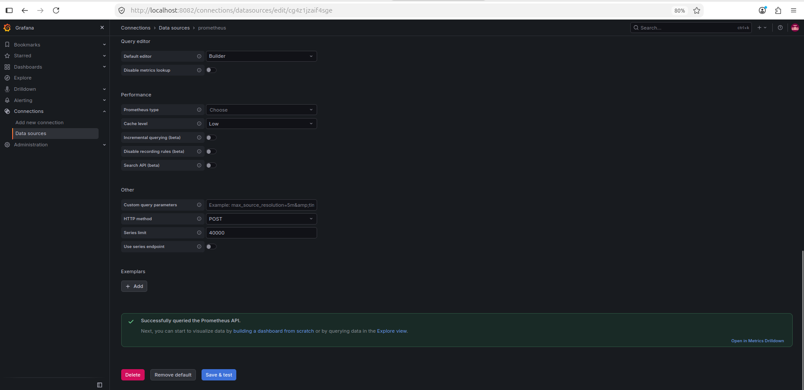

2. Создан Dashboard `API Gateway Monitoring` с панелью `Requests per service` (запрос `sum(rate(http_request_total[$__rate_interval])) by (app_name)`).

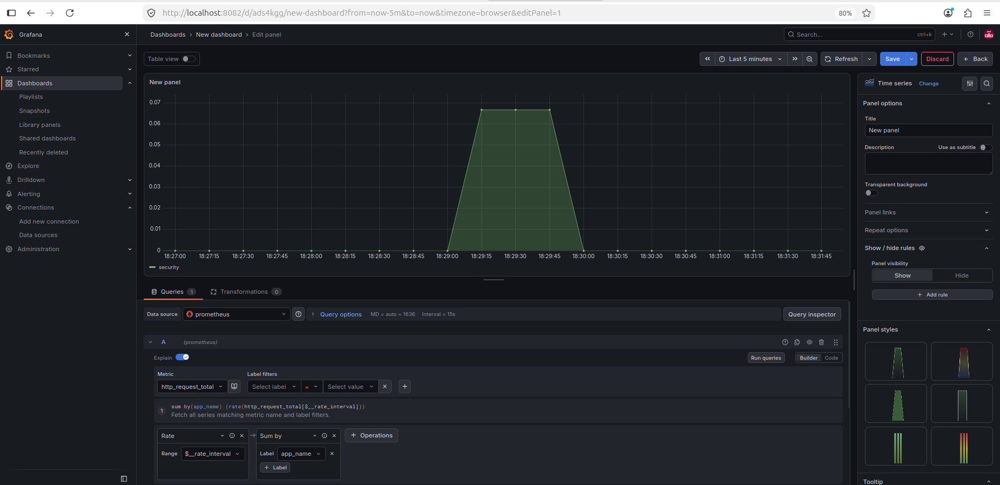

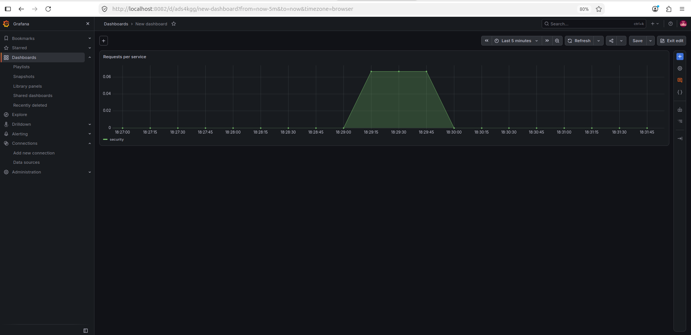

### Результат выполнения: 

docker compose файл, запустив который можно перейти по адресу http://localhost:8081, по которому доступна Grafana с настроенным Dashboard.
Логин в Grafana должен быть admin, пароль qwerty123456.

---

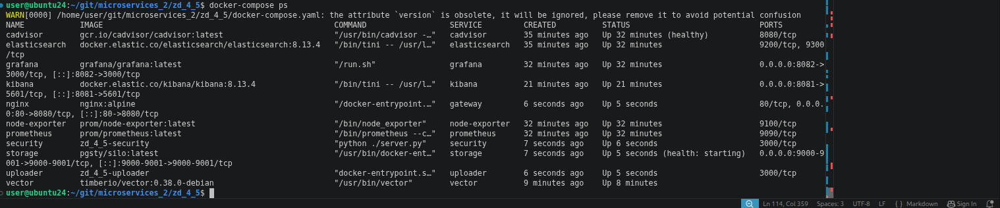

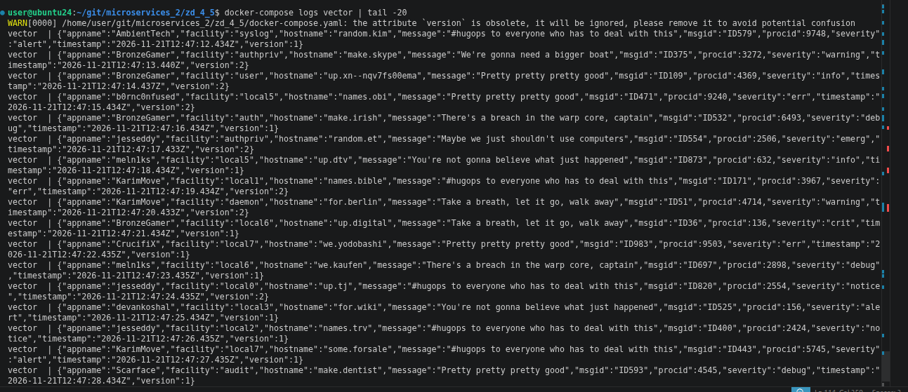

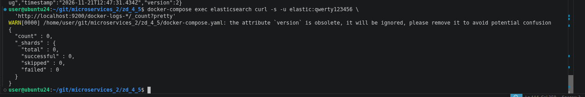

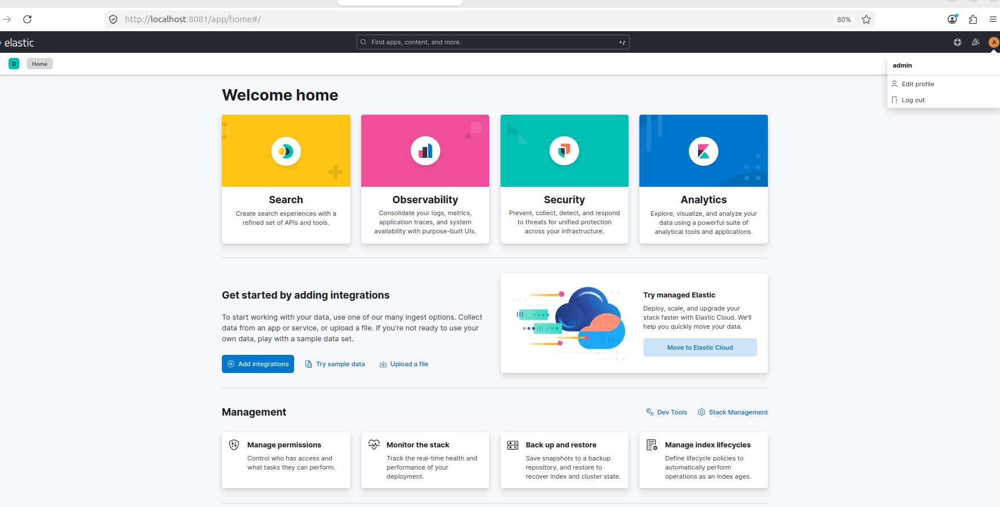

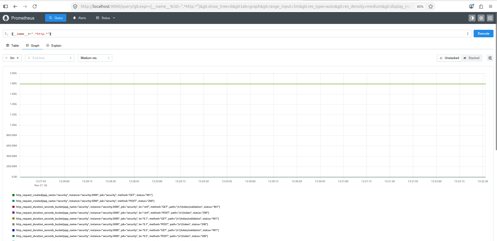

### Как оформить ДЗ?

Выполненное домашнее задание пришлите ссылкой на .md-файл в вашем репозитории.

---